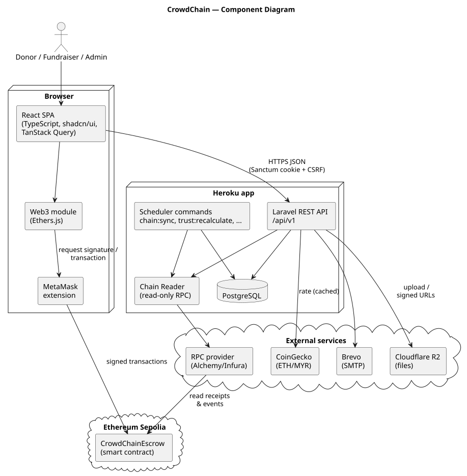
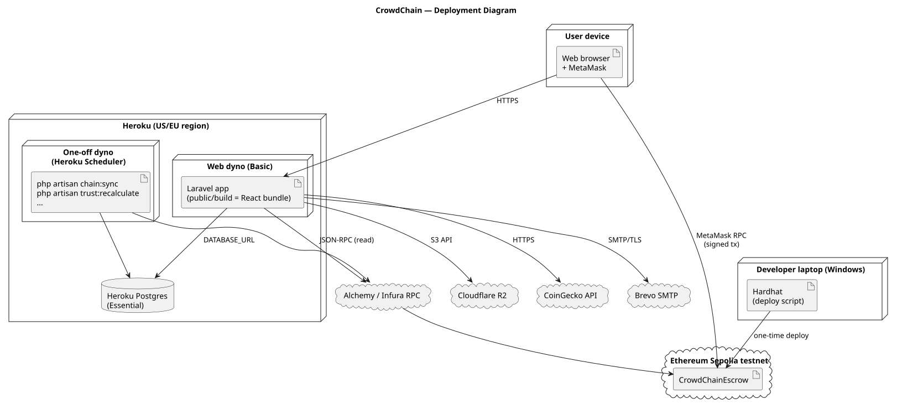

# System Architecture — CrowdChain

Phase 2 · Builds on the [SRS](01-srs.md) and the [Decision Log](00-decision-log.md).

---

## 1. Architectural style

CrowdChain combines three well-known styles. Each one solves a different problem:

| Style | Where | Why (in plain language) |
|---|---|---|
| **Layered architecture** | Laravel backend | Each layer has one job: HTTP → validation → business rules → data. A change in one layer (for example, swapping the email provider) does not ripple through the others. |
| **MVC + SPA** | Laravel is the *Model–Controller* part and exposes JSON. React is the *View*, running in the browser. | The UI and the API can be built, tested and documented separately. This meets the requirement that the frontend talks to the backend only through a documented API. |
| **Hybrid on-chain / off-chain** | Money logic in a smart contract; everything else in PostgreSQL | The blockchain gives tamper-proof money rules. The database gives speed, search and privacy. Neither can do the other's job well. |

## 2. Component view

Source: [`diagrams/component.puml`](diagrams/component.puml)



| Component | Technology | Responsibility |
|---|---|---|
| **React SPA** | React, TypeScript, Vite, shadcn/ui, TanStack Query, React Router | All screens; client-side validation (zod); calls the REST API; talks to MetaMask through the Web3 module. |
| **Web3 module** (inside the SPA) | Ethers.js v6 + MetaMask | Connects the wallet, checks the network (Sepolia), signs messages for wallet linking, sends contract transactions, and returns `txHash` to the API. |
| **Laravel REST API** | Laravel (latest stable at project setup), PHP 8.3+ | Authentication, RBAC, validation, business rules, file handling, transaction verification, notifications, audit log. |
| **Chain Reader** (inside Laravel) | HTTP JSON-RPC client + ABI decoder (`kornrunner/keccak`, `web3p/ethereum-util` or equivalent) | Reads transaction receipts and event logs from Sepolia. **Read-only**: it holds no private key. |
| **Scheduler commands** | Laravel console commands run by Heroku Scheduler | `chain:sync` (every 10 min), `trust:recalculate`, `registrations:check-expiry`, `proofs:check-overdue`, `weekly:queue-due` (daily). |
| **PostgreSQL** | Heroku Postgres | Users, organisations, campaigns, the mirror of on-chain records, audit log, sessions, cache, notifications. |
| **`CrowdChainEscrow`** | Solidity 0.8.x, OpenZeppelin | Holds donations; enforces release and refund rules; emits events. **The source of truth for money.** |
| **Cloudflare R2** | S3-compatible object storage | All uploaded files. Private bucket; access through signed URLs. |
| **CoinGecko** | REST API | ETH→MYR rate (cached for 10 min). |
| **Brevo** | SMTP | Verification, reset and notification emails. |
| **RPC provider** | Alchemy or Infura (Sepolia endpoint) | Gateway for reading the blockchain from the server. The browser uses MetaMask's own RPC. |

## 3. Deployment view

Source: [`diagrams/deployment.puml`](diagrams/deployment.puml)



- **One Heroku app**, with a web dyno running `heroku-php-apache2 public/` (or nginx). At build time, `heroku/nodejs` runs `npm run build`, which emits the React bundle into `public/build`, and then `heroku/php` installs Composer dependencies.
- **Heroku Postgres** (Essential) is attached through `DATABASE_URL`.
- **Heroku Scheduler** runs the commands above on one-off dynos.
- The smart contract is deployed **once** from the developer laptop with Hardhat. Its address is stored in `CONTRACT_ADDRESS`.

**Why a single origin matters:** the SPA and the API share one domain, so the
browser sends the Sanctum session cookie automatically. No CORS configuration
or tokens in JavaScript are needed (see D-44).

## 4. Backend layers

```
HTTP request
   │
   ▼
routes/api.php ──► Middleware (auth:sanctum, role, verified, throttle)
   │
   ▼
Controller          thin: receives the request, calls one service, returns a Resource
   │
   ├─► FormRequest  validation rules + authorize() (calls a Policy)
   │
   ▼
Service             business rules (e.g. CampaignService::approve)
   │      └─► ChainReader / RateService / FileStorage / TrustScoreCalculator
   ▼
Eloquent Model      relationships, casts, scopes
   │
   ▼
PostgreSQL
   │
   ▼
API Resource ──► JSON envelope { data, message, errors }
```

**Rule of thumb:** if code decides *whether* something is allowed or *what*
happens to money or status, it lives in a **Service** or **Policy**, never in
a Controller or a React component (NFR-MAINT-01, -04).

## 5. Data flow

### 5.1 What lives where

| Data | Stored in | Source of truth |
|---|---|---|
| Accounts, organisations, documents (files) | PostgreSQL + R2 | PostgreSQL |
| Campaign text, images, item lists | PostgreSQL + R2 | PostgreSQL |
| Goal, stage amounts, deadline, fundraiser wallet | Contract (+ DB mirror) | **Contract** |
| Donations, releases, refunds | Contract (+ DB mirror) | **Contract** |
| Proof files | R2 | R2 (file); **contract** (hash) |
| Trust Score | PostgreSQL | PostgreSQL (calculated) |

### 5.2 How on-chain data reaches the database

There are two paths, and both are idempotent (they never create duplicates):

1. **Fast path:** right after MetaMask confirms a transaction, the SPA POSTs the `txHash` to the API. The API fetches the receipt, decodes the event, checks it, and stores the record. The user sees the result within seconds.
2. **Safety net:** `chain:sync` runs every 10 minutes. It reads all contract events since the last processed block and inserts anything the fast path missed (for example, when the donor closed the tab).

The unique key `(tx_hash, log_index)` on the `chain_events` table guarantees
that the same event is processed only once, whichever path saw it first.

### 5.3 RM ↔ ETH

```
User types RM ──► API /rates/eth-myr (cached CoinGecko) ──► SPA shows ≈ETH
                                                         └─► MetaMask sends wei
```

The amounts stored on-chain are always **wei** (1 ETH = 10¹⁸ wei). RM values
in the database are **snapshots** taken at the moment of approval or donation,
used for display only.

## 6. Key technical decisions

| # | Decision | Alternatives considered | Why this one |
|---|---|---|---|
| T1 | Amounts stored as **wei in `numeric(78,0)`** | float, `decimal(18,8)` ETH | Floats lose precision with money. 78 digits fit the largest `uint256`. |
| T2 | Internal `bigint` primary keys + public **ULID** | Auto-increment IDs in URLs; UUID v4 | IDs in URLs cannot be guessed (no `/campaigns/1, /2, /3`). ULIDs sort by time, which keeps index performance good. |
| T3 | The **database campaign ID is reused as the on-chain campaign ID** | A separate counter inside the contract | One ID everywhere, which makes event syncing trivial. |
| T4 | **API versioning** `/api/v1` | No version | A breaking change can be shipped as v2 without breaking a running frontend. |
| T5 | **Soft deletes** on users, organisations and campaigns | Hard delete | Required by the audit trail (D-17). |
| T6 | **Database** session and cache drivers | File driver; Redis | The Heroku filesystem is wiped on restart. Redis would cost money. |
| T7 | Sensitive organisation fields (IC number, bank account number) use Laravel's **`encrypted` cast** | Plaintext | Protects personal data if the database is leaked (PDPA). The key is `APP_KEY`. |
| T8 | The proof hash recorded on-chain is **`sha256(invoice_hash ‖ slip_hash [‖ exchange_hash])`** | One on-chain hash per file | The contract stores one `bytes32` per stage, which costs less gas. Anyone can recompute it from the public file hashes. |
| T9 | `finalize()` is **public** and is also called automatically inside `releaseStage` and `claimRefund` | Only the admin finalises | Nobody has to wait for the admin to unlock their refund. |
| T10 | Mermaid for the ERD (renders on GitHub); PlantUML for UML diagrams | draw.io only | Diagrams are text, so they are version-controlled and reviewable in pull requests. |
