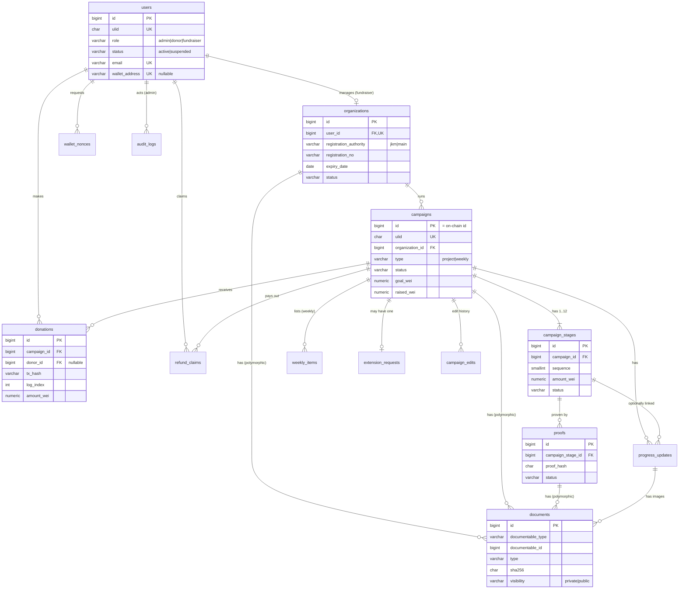
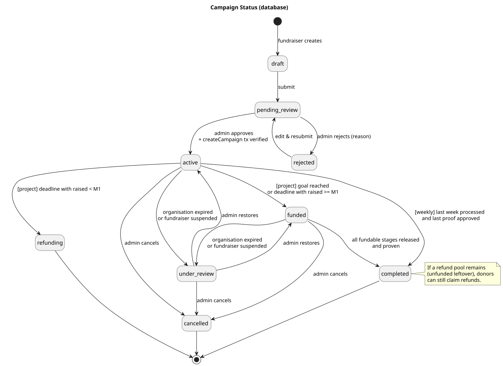

# Database Design — CrowdChain (PostgreSQL)

**Conventions**
- Table names are plural and `snake_case`. Every table has `id bigint` (identity) as its primary key.
- Tables whose rows appear in URLs also have `ulid char(26) unique` (decision T2).
- `created_at` / `updated_at` are on every table unless stated otherwise.
- `deleted_at` (soft delete) is on `users`, `organizations` and `campaigns`.
- ETH amounts are stored in **wei** as `numeric(78,0)` (`*_wei`). RM amounts are `numeric(12,2)` (`*_myr`). Rates are `numeric(18,2)` (MYR per 1 ETH).
- Enums are stored as `varchar` with a `CHECK` constraint (simpler migrations than native PostgreSQL enums), and mirrored as PHP backed enums.
- 🔒 = column uses Laravel's `encrypted` cast (T7). 🔗 = mirrors on-chain data.

---

## 1. ERD

Supporting tables with no relationships drawn above: `chain_events`,
`chain_sync_cursors`, `exchange_rates`, `notifications`, `sessions`, `cache`,
`password_reset_tokens`.

---

## 2. Tables

### 2.1 `users`
| Column | Type | Notes |
|---|---|---|
| id | bigint PK | |
| ulid | char(26) UK | |
| name | varchar(120) | |
| email | varchar(190) UK | stored lowercase |
| email_verified_at | timestamptz null | |
| password | varchar(255) | bcrypt |
| phone | varchar(20) null | |
| role | varchar(12) | `admin`, `donor`, `fundraiser` — fixed after registration |
| status | varchar(12) default `active` | `active`, `suspended` |
| suspended_reason | text null | |
| wallet_address | varchar(42) null UK | lowercase hex; unique across users (D-07) |
| wallet_linked_at | timestamptz null | |
| remember_token | varchar(100) null | |
| timestamps, deleted_at | | |

Indexes: `(role, status)`.

### 2.2 `wallet_nonces`
| Column | Type | Notes |
|---|---|---|
| id | bigint PK | |
| user_id | bigint FK → users | |
| nonce | char(32) UK | random |
| expires_at | timestamptz | now + 5 min |
| used_at | timestamptz null | single use (NFR-SEC-10) |

### 2.3 `organizations`
| Column | Type | Notes |
|---|---|---|
| id, ulid | | |
| user_id | bigint FK → users, UK | one organisation per fundraiser account |
| registration_authority | varchar(4) | `jkm`, `main` |
| main_state | varchar(30) null | required when `main` |
| name | varchar(200) | |
| registration_no | varchar(60) | |
| registration_date | date | |
| expiry_date | date | required (D-16) |
| institution_category | varchar(30) | `childrens_home`, `elderly_care`, `oku`, `tahfiz`, `other_care_centre` |
| ros_ssm_no | varchar(60) null | |
| address | text | |
| postcode | varchar(5) | |
| district | varchar(60) | |
| state | varchar(30) | |
| phone, email | varchar | official contacts |
| beneficiaries_count | integer | |
| bank_name | varchar(60) | |
| bank_account_no 🔒 | text | |
| bank_account_holder | varchar(200) | compared with `name` (FR-UM-07) |
| pic_name, pic_position, pic_phone, pic_email | varchar | |
| pic_ic_no 🔒 | text | |
| status | varchar(12) | `pending`, `verified`, `rejected`, `expired` |
| rejection_reason | text null | |
| verified_at | timestamptz null | |
| verified_by | bigint FK → users null | admin |
| expiry_reminder_sent_at | timestamptz null | avoids repeated reminders |
| timestamps, deleted_at | | |

Indexes: UK `(registration_authority, registration_no)`, `(status)`, `(expiry_date)`.

### 2.4 `documents` (polymorphic, for every uploaded file)
| Column | Type | Notes |
|---|---|---|
| id, ulid | | |
| documentable_type / documentable_id | varchar / bigint | owner: organisation, campaign, proof or progress update |
| type | varchar(30) | `registration_certificate`, `bank_proof`, `pic_letter`, `premises_photo`, `campaign_support`, `cover_image`, `gallery_image`, `update_image`, `proof_invoice`, `proof_transfer_slip`, `proof_exchange_statement` |
| disk | varchar(20) | `r2` |
| path | varchar(255) | random name |
| original_name | varchar(255) | |
| mime | varchar(60) | `application/pdf`, `image/jpeg`, `image/png` |
| size_bytes | integer | ≤ 5 MB |
| sha256 | char(64) | computed at upload |
| visibility | varchar(8) | `private` (KYC, bank, PIC letter) or `public` |
| uploaded_by | bigint FK → users | |

Indexes: `(documentable_type, documentable_id, type)`.

### 2.5 `campaigns`
| Column | Type | Notes |
|---|---|---|
| id | bigint PK | **reused as the on-chain campaign ID** (T3) |
| ulid | char(26) UK | |
| organization_id | bigint FK → organizations | |
| type | varchar(8) | `project`, `weekly` |
| title | varchar(150) | |
| slug | varchar(170) | for readable URLs: `/campaigns/{ulid}/{slug}` |
| description | text | |
| category | varchar(30) | `food_daily_needs`, `education`, `healthcare`, `facilities_maintenance`, `emergency`, `others` |
| status | varchar(20) | see §3 |
| rejection_reason | text null | |
| goal_myr | numeric(12,2) | entered by the fundraiser. For weekly = weekly_amount × weeks |
| duration_days | smallint null | project only, 7–90 |
| weekly_amount_myr | numeric(12,2) null | weekly only |
| weeks_count | smallint null | weekly only, 4–12 |
| release_weekday | smallint null | weekly only, 1 = Monday … 7 = Sunday |
| start_date | date null | weekly only |
| rate_myr_per_eth | numeric(18,2) null | snapshot at approval |
| goal_wei 🔗 | numeric(78,0) null | set at approval |
| raised_wei 🔗 | numeric(78,0) default 0 | |
| released_wei 🔗 | numeric(78,0) default 0 | |
| refund_pool_wei 🔗 | numeric(78,0) default 0 | |
| deadline_at 🔗 | timestamptz null | project: approval + duration. weekly: last scheduled date |
| extension_used | boolean default false | |
| docs_hash 🔗 | char(64) null | hash of the approved campaign documents |
| create_tx_hash 🔗 | char(66) null UK | |
| trust_score | smallint null | 0–100 |
| risk_level | varchar(6) null | `low`, `medium`, `high` |
| trust_breakdown | jsonb null | per-component scores |
| proof_overdue | boolean default false | |
| cancel_reason | text null | |
| submitted_at, approved_at, funded_at, completed_at, cancelled_at | timestamptz null | |
| timestamps, deleted_at | | |

Indexes: `(status, category)`, `(organization_id, status)`, `(deadline_at)`,
`(trust_score)`, `(approved_at)`. Trigram index on `title` (`pg_trgm`) for
keyword search with `ILIKE`.

### 2.6 `campaign_stages` (milestones and weeks)
| Column | Type | Notes |
|---|---|---|
| id | bigint PK | |
| campaign_id | bigint FK → campaigns | |
| sequence | smallint | 0-based, the same index as on-chain |
| title | varchar(150) | project: milestone title; weekly: "Week N" |
| description | text null | |
| amount_myr | numeric(12,2) | |
| amount_wei 🔗 | numeric(78,0) null | |
| due_date | date | project: expected date; weekly: scheduled release date |
| status | varchar(20) | `pending`, `release_requested`, `released`, `unfunded`, `cancelled` |
| release_requested_at | timestamptz null | |
| released_at 🔗 | timestamptz null | |
| release_tx_hash 🔗 | char(66) null UK | |
| proof_hash 🔗 | char(64) null | set when the approved proof is recorded on-chain |
| proof_due_at | timestamptz null | `released_at` + 30 days, used for the Proof Overdue check |

Unique: `(campaign_id, sequence)`.

### 2.7 `weekly_items`
| Column | Type | Notes |
|---|---|---|
| id | bigint PK | |
| campaign_id | bigint FK → campaigns | weekly campaigns only |
| name | varchar(100) | e.g. "Beras 10kg" |
| quantity | numeric(10,2) | |
| unit | varchar(20) | |
| est_price_myr | numeric(12,2) | the items sum to `weekly_amount_myr` |

### 2.8 `donations` 🔗
| Column | Type | Notes |
|---|---|---|
| id, ulid | | |
| campaign_id | bigint FK → campaigns | |
| donor_id | bigint FK → users null | null if the wallet is not linked to any account (found by sync) |
| wallet_address | varchar(42) | |
| amount_wei | numeric(78,0) | |
| amount_myr | numeric(12,2) | snapshot |
| rate_myr_per_eth | numeric(18,2) | snapshot |
| is_anonymous | boolean default false | |
| tx_hash | char(66) | |
| log_index | integer | |
| block_number | bigint | |
| confirmed_at | timestamptz | block time |

Unique: `(tx_hash, log_index)`. Indexes: `(campaign_id, confirmed_at)`, `(donor_id)`.

### 2.9 `refund_claims` 🔗
| Column | Type | Notes |
|---|---|---|
| id | bigint PK | |
| campaign_id | bigint FK | |
| donor_id | bigint FK null | |
| wallet_address | varchar(42) | |
| amount_wei | numeric(78,0) | |
| tx_hash, log_index, block_number | | unique `(tx_hash, log_index)` |
| claimed_at | timestamptz | |

### 2.10 `proofs`
| Column | Type | Notes |
|---|---|---|
| id, ulid | | |
| campaign_stage_id | bigint FK → campaign_stages | several rows are possible (rejected, then resubmitted) |
| amount_spent_myr | numeric(12,2) | |
| description | text | |
| proof_hash | char(64) | `sha256(invoice ‖ slip [‖ exchange])` (T8) |
| status | varchar(10) | `pending`, `approved`, `rejected` |
| rejection_reason | text null | |
| reviewed_by | bigint FK → users null | |
| reviewed_at | timestamptz null | |
| record_tx_hash 🔗 | char(66) null UK | `recordProof` transaction |

Partial unique index: one `approved` proof per stage.

### 2.11 `progress_updates`
| Column | Type | Notes |
|---|---|---|
| id, ulid | | |
| campaign_id | bigint FK | |
| campaign_stage_id | bigint FK null | optional link |
| body | text | |
| timestamps | | images live in `documents` (max 5) |

### 2.12 `extension_requests`
| Column | Type | Notes |
|---|---|---|
| id | bigint PK | |
| campaign_id | bigint FK UK | at most one per campaign (D-24) |
| reason | text | |
| status | varchar(10) | `pending`, `approved`, `rejected` |
| rejection_reason | text null | |
| new_deadline_at | timestamptz null | |
| reviewed_by, reviewed_at | | |
| tx_hash 🔗 | char(66) null | |

### 2.13 `campaign_edits`
`id, campaign_id FK, user_id FK, field varchar(30), old_value text, new_value text, created_at` — append-only (FR-CC-09).

### 2.14 `audit_logs` (append-only)
| Column | Type | Notes |
|---|---|---|
| id | bigint PK | |
| actor_id | bigint FK → users | |
| action | varchar(40) | e.g. `organization.approved`, `stage.released` |
| auditable_type / auditable_id | | target |
| reason | text null | |
| tx_hash | char(66) null | |
| metadata | jsonb null | before/after values |
| ip_address | inet null | |
| created_at | timestamptz | **no `updated_at`; the application never updates or deletes rows** |

Indexes: `(auditable_type, auditable_id)`, `(action, created_at)`.

### 2.15 `chain_events` (idempotency ledger)
| Column | Type | Notes |
|---|---|---|
| id | bigint PK | |
| tx_hash | char(66) | |
| log_index | integer | |
| block_number | bigint | |
| event_name | varchar(40) | |
| campaign_id | bigint null | |
| payload | jsonb | decoded arguments |
| processed_at | timestamptz | |

Unique: `(tx_hash, log_index)` (§5.2 of the architecture document).

### 2.16 `chain_sync_cursors`
`id, contract_address varchar(42) UK, last_block bigint, updated_at`

### 2.17 `exchange_rates`
`id, source varchar(20), myr_per_eth numeric(18,2), fetched_at timestamptz` — keeps history for the fallback (NFR-REL-03).

### 2.18 Laravel defaults
`notifications` (UUID id, morphs notifiable, data jsonb, read_at), `sessions`,
`cache`, `cache_locks`, `password_reset_tokens`.

---

## 3. Status models

### 3.1 Campaign status (database)

Source: [`diagrams/campaign-state.puml`](diagrams/campaign-state.puml)

| Status | Meaning | Accepts donations |
|---|---|---|
| `draft` | Being prepared by the fundraiser | — |
| `pending_review` | Submitted, waiting for the admin | — |
| `rejected` | Rejected with a reason; editable and resubmittable | — |
| `active` | Created on-chain, public | ✅ |
| `funded` | Project goal reached (or finalised with ≥ M1). Releasing stages | — |
| `under_review` | Organisation expired or suspended; the admin decides | — (UI blocks it; the contract does not know about this status) |
| `refunding` | Finalised below M1, cancelled, or leftover only; donors claim refunds | — |
| `completed` | All fundable stages released and proven | — |
| `cancelled` | Cancelled by the admin (refunds available) | — |

> `under_review` exists only off-chain. The UI disables donations, and
> the admin either restores the campaign to `active` or cancels it on-chain.

### 3.2 Stage status
`pending → release_requested → released` (then proof `pending → approved`), or
`pending → unfunded`, or `pending → cancelled` (when the campaign is cancelled).

### 3.3 Organisation status
`pending → verified | rejected`; `rejected → pending` (resubmit);
`verified → expired` (scheduler); `expired → pending` (renewal uploaded).

---

## 4. Data integrity rules (enforced in Services + DB constraints)

1. Sum of `campaign_stages.amount_myr` = `campaigns.goal_myr` (validated in the Form Request). The same rule applies to `amount_wei` (enforced by the contract).
2. Only **one** `approved` proof per stage (partial unique index).
3. `donations` and `refund_claims` are written **only** from verified chain events, never from user input.
4. `raised_wei`, `released_wei` and `refund_pool_wei` are recomputed from events, never incremented blindly. Recomputing makes the sync idempotent.
5. Multi-table writes use `DB::transaction()`.
