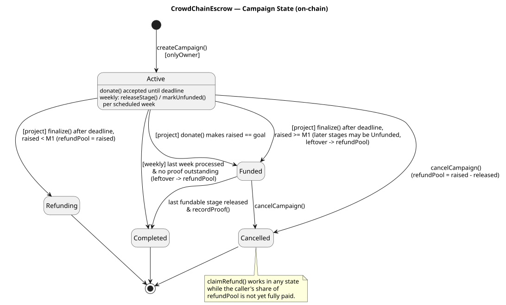

# Smart Contract Design — `CrowdChainEscrow`

- **Network:** Ethereum Sepolia
- **Language:** Solidity ^0.8.24 (built-in overflow checks)
- **Libraries:** OpenZeppelin Contracts v5 — `Ownable`, `ReentrancyGuard`, `Pausable`
- **Upgradeable:** no (D-05)

This is a **design**, not the implementation. Function signatures may change
slightly during coding. Any change will be recorded here.

---

## 1. Responsibilities

| The contract **does** | The contract **does not** |
|---|---|
| Hold donated ETH in escrow | Store names, documents or any personal data |
| Enforce goal caps, deadlines and release order | Decide whether an organisation is genuine (the admin does, off-chain) |
| Pay the fundraiser wallet when the admin releases a stage | Convert ETH to RM |
| Record proof hashes | Store proof files |
| Compute and pay pro-rata refunds | Push refunds automatically (donors pull) |

## 2. Data model

```solidity
enum CampaignType  { Project, Weekly }
enum CampaignState { None, Active, Funded, Refunding, Completed, Cancelled }
enum StageState    { Pending, Released, Unfunded, Cancelled }

struct Campaign {
    address  fundraiser;      // receiving wallet (locked at creation)
    CampaignType ctype;
    CampaignState state;
    uint64   deadline;        // project: donation deadline; weekly: last scheduled date
    bool     extended;        // one 30-day extension used (project only)
    bool     awaitingProof;   // true after a release until recordProof()
    uint8    stageCount;      // project 1–5, weekly 4–12
    uint8    nextStage;       // index of the next stage to process
    uint8    fundableStages;  // project: set by finalize(); weekly: = stageCount
    uint256  goal;            // wei; = sum(stageAmount)
    uint256  raised;          // wei donated
    uint256  released;        // wei paid to the fundraiser
    uint256  refundPool;      // wei made refundable (cumulative)
    bytes32  docsHash;        // hash of the approved campaign documents
}

mapping(uint256 => Campaign) public campaigns;                       // id = DB campaign id
mapping(uint256 => uint256[]) private _stageAmount;                  // wei per stage
mapping(uint256 => uint64[])  private _stageTime;                    // weekly: release time per week
mapping(uint256 => mapping(uint8 => StageState)) public stageState;
mapping(uint256 => mapping(uint8 => bytes32))    public proofHash;
mapping(uint256 => mapping(address => uint256))  public contributed; // donor → wei
mapping(uint256 => mapping(address => uint256))  public refunded;    // donor → wei already refunded
```

**Escrow balance of a campaign** = `raised − released − refundPool`.
This is the money that is still available for future stages.

## 3. Functions

### 3.1 Admin (`onlyOwner`)

| Function | Rules (`require`) | Effect | Event |
|---|---|---|---|
| `createCampaign(id, fundraiser, ctype, deadline, amounts[], times[], docsHash)` | `id` unused; `fundraiser ≠ 0`; project: 1–5 amounts, `times` empty, `deadline > now`; weekly: 4–12 amounts, all equal, `times` strictly increasing, `deadline = times[last]` | Stores the campaign, `state = Active`, `goal = Σ amounts` | `CampaignCreated(id, fundraiser, ctype, goal, deadline, docsHash)` |
| `extendDeadline(id)` | project; `Active`; `!extended`; `now < deadline`; `raised < goal` | `deadline += 30 days`; `extended = true` | `DeadlineExtended(id, newDeadline)` |
| `releaseStage(id, i)` | auto-`finalize` if needed; `i == nextStage`; `!awaitingProof`; stage is `Pending`; **project:** `state == Funded` and `i < fundableStages`; **weekly:** `state == Active`, `now ≥ times[i]`; escrow balance ≥ amount | `released += amount`; stage `Released`; `nextStage++`; `awaitingProof = true`; send ETH to `fundraiser` (last step) | `StageReleased(id, i, amount, fundraiser)` |
| `markUnfunded(id, i)` | **weekly only**; `i == nextStage`; `now ≥ times[i]`; escrow balance < amount | Stage `Unfunded`; `nextStage++` (funds carry forward); if it was the last week and `!awaitingProof` → `_complete(id)` | `StageUnfunded(id, i)` |
| `recordProof(id, i, hash)` | stage `i` is `Released`; `proofHash[id][i] == 0`; `hash ≠ 0` | Stores the hash; `awaitingProof = false`; if every fundable stage is processed → `_complete(id)` | `ProofRecorded(id, i, hash)` |
| `cancelCampaign(id)` | `state ∈ {Active, Funded}` | `refundPool = raised − released`; remaining stages `Cancelled`; `state = Cancelled` | `CampaignCancelled(id, refundPool)` |
| `pause()` / `unpause()` | — | Blocks `donate`, `releaseStage`, `claimRefund` | OZ `Paused` / `Unpaused` |

### 3.2 Public

| Function | Rules | Effect | Event |
|---|---|---|---|
| `donate(id)` `payable` | `whenNotPaused`; `state == Active`; `now < deadline`; `msg.value > 0`; `raised + msg.value ≤ goal` | `contributed[msg.sender] += value`; `raised += value`; project: if `raised == goal` → `state = Funded`, `fundableStages = stageCount` | `DonationReceived(id, donor, amount)`; maybe `CampaignFunded(id)` |
| `finalize(id)` | project; `state == Active`; `now ≥ deadline` | Finds the largest `k` with Σ amounts[0..k−1] ≤ raised. `k == stageCount` → `Funded`. `1 ≤ k < stageCount` → `Funded`, stages `k…` `Unfunded`, `refundPool = raised − Σ[0..k−1]`. `k == 0` → `Refunding`, `refundPool = raised` | `CampaignFinalized(id, state, k, refundPool)` |
| `claimRefund(id)` | `nonReentrant`, `whenNotPaused`; auto-`finalize` if needed; `owed = contributed × refundPool / raised − refunded`; `owed > 0` | `refunded += owed`; send ETH (last step) | `RefundClaimed(id, donor, owed)` |
| Views | — | `getStages(id)`, `escrowBalance(id)`, `refundableOf(id, donor)` | — |

### 3.3 Internal `_complete(id)`
Sets `state = Completed`. For weekly campaigns, it also moves any leftover
into the refund pool: `refundPool += raised − released − refundPool`.

> **Why `refunded` is cumulative instead of a `bool`:** a project can first be
> finalised with a small leftover refund pool and *later* be cancelled, which
> enlarges the pool. A donor who already claimed the first part can then claim
> the difference. A `bool` would wrongly block that second claim.

## 4. State machine

Source: [`diagrams/contract-state.puml`](diagrams/contract-state.puml)



## 5. Rule matrix (worked examples)

Project goal 10 ETH; M1 = 3, M2 = 4, M3 = 3.

| Raised at deadline | `finalize` result | Releasable | Refund pool |
|---|---|---|---|
| 10 | Funded, k = 3 | M1, M2, M3 | 0 |
| 8 | Funded, k = 2 (3+4 = 7 ≤ 8) | M1, M2 | 1 ETH pro-rata |
| 5 | Funded, k = 1 | M1 | 2 ETH pro-rata |
| 2 | Refunding, k = 0 | — | 2 ETH (100%) |
| 8, then admin cancels after M1 released | Cancelled | — | 8 − 3 = 5 ETH (a donor who claimed their share of the 1 ETH can then claim the rest) |

Weekly: 8 weeks × 0.1 ETH (goal 0.8 ETH).

| Week | Escrow before | Action | Escrow after |
|---|---|---|---|
| 1 | 0.25 | release | 0.15 |
| 2 | 0.15 | release (needs week 1 proof) | 0.05 |
| 3 | 0.05 | **markUnfunded** | 0.05 (carried forward) |
| 4 | 0.12 (new donations) | release | 0.02 |
| … | | | |
| End | 0.02 leftover | `_complete` | refund pool 0.02, pro-rata |

## 6. Security measures

| Threat | Measure |
|---|---|
| Reentrancy (attacker contract calls back during an ETH transfer) | `nonReentrant` on `releaseStage` and `claimRefund`; **checks-effects-interactions**: all state is updated *before* the ETH `call` |
| Failed transfer silently ignored | `(bool ok,) = to.call{value: x}(""); require(ok)` |
| Unauthorised release or cancel | `onlyOwner` (admin wallet) |
| Gas-limit DoS from looping over donors | No loops over donors; refunds are pulled |
| Rounding dust in pro-rata refunds | Integer division rounds **down**, so total payouts never exceed the pool; the dust (a few wei) stays in the contract |
| Overfunding | `raised + value ≤ goal` |
| Releases skipping proof | `awaitingProof` flag blocks the next release until `recordProof` |
| Emergency | `Pausable` |
| Integer overflow | Solidity ≥0.8 checked arithmetic |
| Forcing ETH into the contract (`selfdestruct`) | Accounting uses the `raised`/`released` counters, not `address(this).balance` |

## 7. Off-chain rules the contract deliberately does not enforce

| Rule | Enforced by | Why off-chain |
|---|---|---|
| Admin may cancel only for fraud or >30 days late | Laravel policy + audit log (reason required) | Needs human judgment |
| Limit of 1 weekly + 2 project campaigns per fundraiser | Laravel | Business policy, cheaper off-chain |
| Minimum donation ≈RM 5 | Laravel + UI | RM rate is off-chain |
| `under_review` freeze | Laravel + UI | Temporary state; the admin can cancel on-chain if needed |
| Proof file contents valid | Admin review | Requires reading the documents |

## 8. Testing plan (Hardhat + Chai)

Every external function gets tests for: the happy path, each `require`
failing, the emitted events, and the effect on balances. Additional
scenarios:
- every row of the §5 matrix
- reentrancy attack contracts on `releaseStage` and `claimRefund`
- non-owner calls
- donations after the deadline
- a donation exceeding the goal
- double refund claims
- partial-then-cancel claim
- pause behaviour
- weekly `markUnfunded` called when the funds are actually sufficient (must revert)

Target: 100% function coverage (NFR-MAINT-06).

## 9. Clarification introduced by this design

**Extension applies to Project campaigns only.** Weekly campaigns have no
fundraising deadline in the same sense: donations stay open until the last
week. *Confirmed by the student (Decision Log D-59).*
