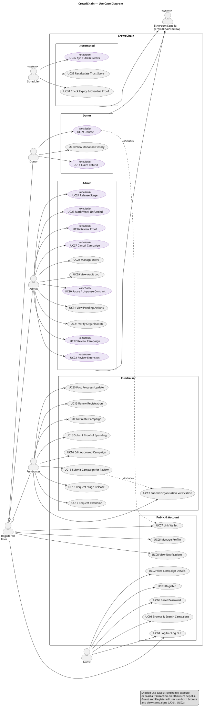

# Use Cases — CrowdChain

## 1. Use case diagram

Source: [`diagrams/use-case.puml`](diagrams/use-case.puml)

**Actors**

| Actor | Type | Description |
|---|---|---|
| Guest | Primary | Visitor who is not logged in |
| Registered User | Primary (abstract) | Generalisation of Donor, Fundraiser and Admin |
| Donor | Primary | Donates and claims refunds |
| Fundraiser | Primary | PIC of a JKM/MAIN-registered organisation |
| Admin | Primary | Single platform administrator; owner of the contract |
| Scheduler | Secondary (system) | Heroku Scheduler running Laravel commands |
| Ethereum Sepolia (via MetaMask) | Secondary (system) | Executes and records contract transactions |

## 2. Use case list

| ID | Use case | Actor | FR |
|---|---|---|---|
| UC01 | Browse & Search Campaigns | Guest, User | FR-CC-10 |
| UC02 | View Campaign Details | Guest, User | FR-CC-11, FR-PP-07, FR-TS-04 |
| UC03 | Register | Guest | FR-UM-01, -02 |
| UC04 | Log In / Log Out | Guest, User | FR-UM-03 |
| UC05 | Manage Profile | User | FR-UM-05 |
| UC06 | Reset Password | Guest | FR-UM-04 |
| UC07 | Link Wallet | Donor, Fundraiser | FR-UM-13, -14 |
| UC08 | View Notifications | User | FR-NT-01 |
| UC09 | Donate | Donor | FR-CC-12, -13 |
| UC10 | View Donation History | Donor | FR-CC-16 |
| UC11 | Claim Refund | Donor | FR-FR-08 |
| UC12 | Submit Organisation Verification | Fundraiser | FR-UM-06, -07 |
| UC13 | Renew Registration | Fundraiser | FR-UM-12 |
| UC14 | Create Campaign (Project / Weekly) | Fundraiser | FR-CC-01–04 |
| UC15 | Submit Campaign for Review | Fundraiser | FR-CC-05, -08 |
| UC16 | Edit Approved Campaign | Fundraiser | FR-CC-09 |
| UC17 | Request Extension | Fundraiser | FR-CC-15 |
| UC18 | Request Stage Release | Fundraiser | FR-FR-03, FR-PP-05 |
| UC19 | Submit Proof of Spending | Fundraiser | FR-PP-02, -03 |
| UC20 | Post Progress Update | Fundraiser | FR-PP-01 |
| UC21 | Verify Organisation | Admin | FR-UM-08 |
| UC22 | Review Campaign | Admin | FR-CC-06, -07 |
| UC23 | Review Extension | Admin | FR-CC-15 |
| UC24 | Release Stage | Admin | FR-FR-03–06 |
| UC25 | Mark Week Unfunded | Admin | FR-FR-05 |
| UC26 | Review Proof | Admin | FR-PP-04 |
| UC27 | Cancel Campaign | Admin | FR-FR-07 |
| UC28 | Manage Users | Admin | FR-UM-15, -16 |
| UC29 | View Audit Log | Admin | FR-AU-02 |
| UC30 | Pause / Unpause Contract | Admin | FR-FR-09 |
| UC31 | View Pending Actions | Admin | FR-FR-12 |
| UC32 | Sync Chain Events | Scheduler | FR-FR-11 |
| UC33 | Recalculate Trust Score | Scheduler | FR-TS-03 |
| UC34 | Check Expiry & Overdue Proof | Scheduler | FR-UM-10, FR-PP-06 |

---

## 3. Use case descriptions (key use cases)

### UC07 — Link Wallet
| | |
|---|---|
| **Actor** | Donor or Fundraiser |
| **Pre-conditions** | Logged in; email verified; MetaMask installed |
| **Main flow** | 1. The user clicks "Connect wallet". 2. The SPA asks MetaMask for the account and switches it to Sepolia. 3. The SPA requests a nonce from the API. 4. MetaMask shows the message "CrowdChain wallet link · nonce …" and the user signs it. 5. The SPA sends the address and signature. 6. The API recovers the signer from the signature, checks that it equals the address, that the nonce is unused and not expired, and that the address is not linked to another account. 7. The API saves the address and marks the nonce as used. |
| **Alternative** | 4a. The user rejects the signature → "Signature cancelled", nothing is saved. 6a. The address belongs to another account → 422 error. 6b. The nonce has expired → the user is asked to retry. |
| **Post-condition** | The account has a linked wallet. |

### UC09 — Donate
| | |
|---|---|
| **Actor** | Donor (secondary: Ethereum) |
| **Pre-conditions** | Logged in; email verified; wallet linked; campaign `active` and accepting donations; MetaMask on Sepolia with enough ETH |
| **Main flow** | 1. The donor enters an RM amount and optionally ticks "Donate anonymously". 2. The SPA shows the ETH equivalent using the cached rate and validates min ≈RM 5 and max = remaining. 3. The donor confirms. 4. MetaMask shows `donate(id)` with the exact ETH value, and the donor approves. 5. The SPA shows "Pending…" and waits for 1 confirmation. 6. The SPA POSTs `{txHash, isAnonymous}` to the API. 7. The API verifies the receipt (success, contract address, `DonationReceived` event, campaign id, sender = the linked wallet) and stores the donation idempotently. 8. The SPA refreshes the progress bar and shows a success toast with an Etherscan link. |
| **Alternative** | 4a. The donor rejects → nothing happens. 4b. Wrong network → the SPA asks MetaMask to switch to Sepolia. 5a. The transaction reverts (goal exceeded, deadline passed) → a plain-English error. 6a. The tab closes before step 6 → `chain:sync` records the donation within 10 minutes. |
| **Post-condition** | The ETH is in escrow; the donation is recorded on-chain and in the DB; the campaign may become `funded`. |

### UC11 — Claim Refund
| | |
|---|---|
| **Actor** | Donor |
| **Pre-conditions** | The donor has a refundable share (`refundableOf > 0`) |
| **Main flow** | 1. The donation history shows "Refund available ≈RM x". 2. The donor clicks "Claim". 3. MetaMask `claimRefund(id)`. 4. The contract finalises if needed, computes the owed amount and sends ETH. 5. The SPA sends the `txHash`; the API records a `refund_claims` row. |
| **Alternative** | 3a. Nothing is owed → the contract reverts; the button is hidden when the view function returns 0. |
| **Post-condition** | The donor's wallet receives the refund; it cannot be claimed twice. |

### UC12 — Submit Organisation Verification
| | |
|---|---|
| **Actor** | Fundraiser |
| **Pre-conditions** | Logged in as Fundraiser; email verified |
| **Main flow** | 1. The fundraiser opens a 3-step form (Organisation → Bank → PIC). 2. Enters the details and uploads the certificate, bank proof, PIC letter and premises photos. 3. The SPA validates with zod. 4. Submit → the API validates (Form Request), stores the files privately in R2 with SHA-256, saves the organisation as `pending`, and notifies the admin. |
| **Alternative** | 4a. The bank holder name differs from the organisation name → saved with a warning flag for the admin. 4b. The registration number already exists → 422. |
| **Post-condition** | The organisation is `pending`; it appears in the admin's Pending Actions. |

### UC21 — Verify Organisation
| | |
|---|---|
| **Actor** | Admin |
| **Pre-conditions** | An organisation is `pending` |
| **Main flow** | 1. The admin opens the application from Pending Actions. 2. Views each document through 5-minute signed URLs. 3. Checks the certificate details against the form, the bank name match, and the PIC letter. 4. Approves. 5. The API sets `verified`, writes an audit log entry, and notifies the fundraiser. |
| **Alternative** | 4a. Rejects with a reason → `rejected`; the fundraiser can edit and resubmit. |
| **Post-condition** | The fundraiser can create campaigns. |

### UC22 — Review Campaign
| | |
|---|---|
| **Actor** | Admin (secondary: Ethereum) |
| **Pre-conditions** | The campaign is `pending_review`; the organisation is `verified` and not expired; the admin wallet is connected |
| **Main flow** | 1. The admin reviews the content, stages and documents. 2. Clicks "Approve & publish". 3. The API returns the on-chain parameters: id, fundraiser wallet, wei amounts converted at the current rate, times, deadline, docs hash. 4. MetaMask `createCampaign(...)`; the admin approves. 5. The SPA sends the `txHash`. 6. The API verifies the `CampaignCreated` event matches the parameters, then sets `active`, stores the snapshots, writes an audit log entry, and notifies the fundraiser. |
| **Alternative** | 2a. Reject with a reason → `rejected`. 4a. The admin cancels MetaMask → stays `pending_review`. 6a. The event does not match → the transaction is not accepted; the error is logged. |
| **Post-condition** | The campaign is public and accepts donations. |

### UC18 + UC24 — Request and Release Stage
| | |
|---|---|
| **Actors** | Fundraiser (UC18), Admin (UC24) |
| **Pre-conditions** | Project: `funded` (or finalisable). Weekly: scheduled date reached. The previous stage's proof is approved. Escrow balance ≥ amount. |
| **Main flow** | 1. Project: the fundraiser clicks "Request release" for stage N (weekly: the scheduler queues it automatically on the due date). 2. The stage becomes `release_requested` and appears in Pending Actions. 3. The admin opens it and checks the conditions shown. 4. MetaMask `releaseStage(id, N)`. 5. The API verifies `StageReleased`, sets the stage to `released`, sets `proof_due_at`, audits, and notifies the fundraiser and donors. |
| **Alternative** | 3a. Weekly with insufficient escrow → the admin uses UC25 (`markUnfunded`). 4a. The contract reverts (proof missing) → error shown; the stage stays requested. |
| **Post-condition** | ETH is in the fundraiser's wallet; the proof is now due. |

### UC19 + UC26 — Submit and Review Proof
| | |
|---|---|
| **Actors** | Fundraiser (UC19), Admin (UC26) |
| **Pre-conditions** | The stage is `released`; no approved proof yet |
| **Main flow** | 1. The fundraiser uploads the invoice/receipt, the transfer slip, the amount spent, a description, and optionally the exchange statement. 2. The API stores the files (public), computes each SHA-256 and the combined `proof_hash`, and sets the proof to `pending`. 3. The admin compares the files with the stage or item list. 4. Approves → MetaMask `recordProof(id, N, proof_hash)`. 5. The API verifies `ProofRecorded`, marks the proof `approved`, recalculates the Trust Score, and notifies the fundraiser. |
| **Alternative** | 4a. Rejects with a reason → the fundraiser resubmits (back to step 1). |
| **Post-condition** | The next stage can be released; anyone can verify the hash on Etherscan. |

### UC27 — Cancel Campaign
| | |
|---|---|
| **Actor** | Admin |
| **Pre-conditions** | The campaign is `active`, `funded` or `under_review` |
| **Main flow** | 1. The admin clicks "Cancel" and enters a mandatory reason (fraud, or a stage more than 30 days late). 2. MetaMask `cancelCampaign(id)`. 3. The API verifies `CampaignCancelled`, sets `cancelled` and the refund pool, audits, and notifies the donors that a refund is available. |
| **Post-condition** | Donors can claim pro-rata refunds of the unreleased balance (UC11). |

### UC32 — Sync Chain Events
| | |
|---|---|
| **Actor** | Scheduler (every 10 minutes) |
| **Main flow** | 1. Read `last_block` from `chain_sync_cursors`. 2. `eth_getLogs` for the contract from `last_block + 1` up to `latest − 2` (wait for 2 confirmations), in chunks of ≤ 5,000 blocks. 3. For each log: decode it; skip it if `(tx_hash, log_index)` already exists in `chain_events`; otherwise apply it (insert a donation/refund, update the stage or campaign) inside a DB transaction. 4. Save the new `last_block`. |
| **Alternative** | 2a. The RPC fails → exit, retry on the next run (the cursor is unchanged). |
| **Post-condition** | The DB mirror matches the chain. |
