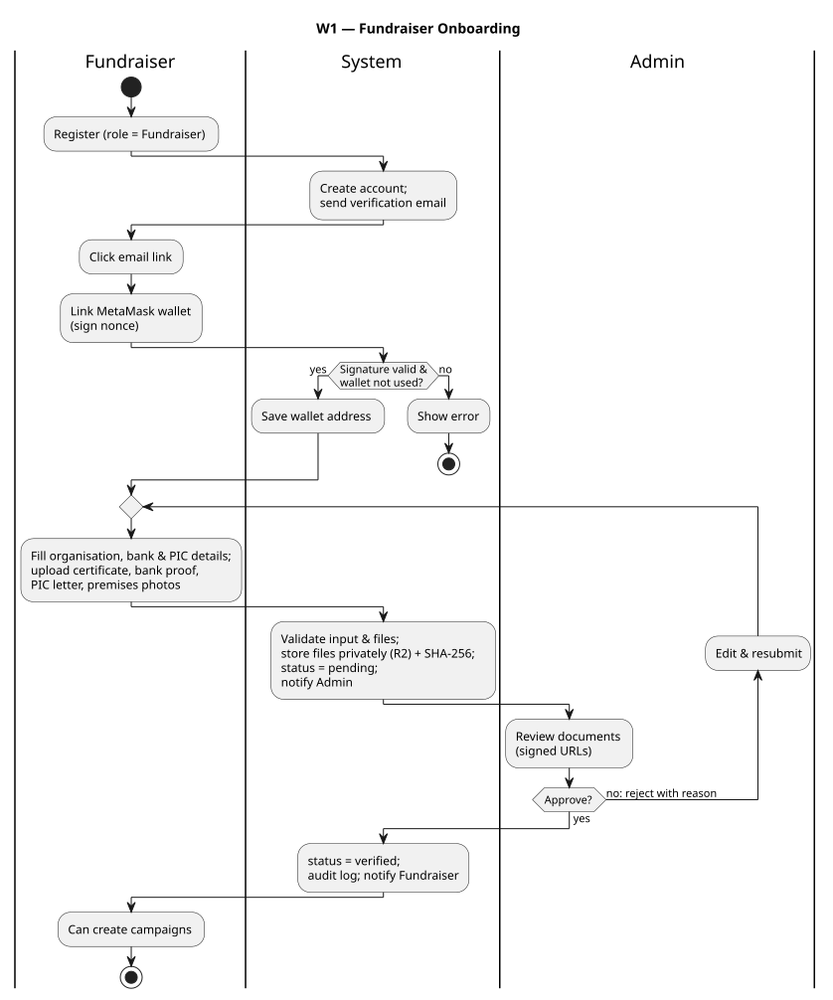
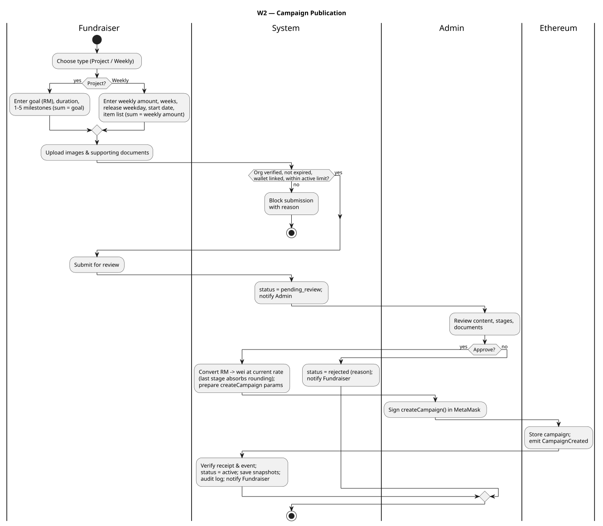
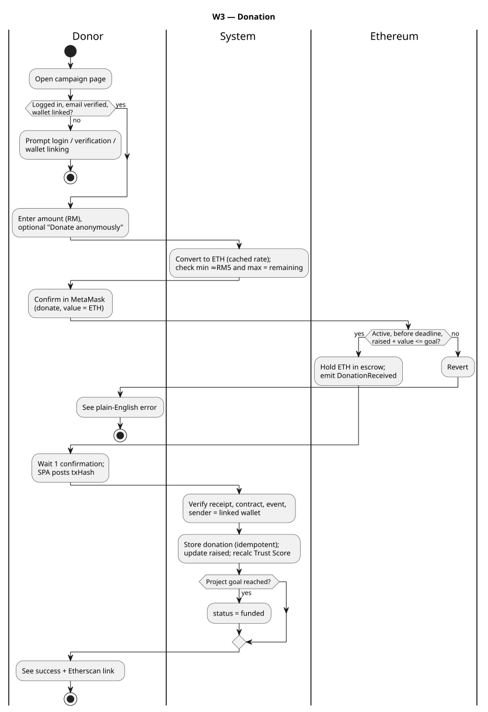
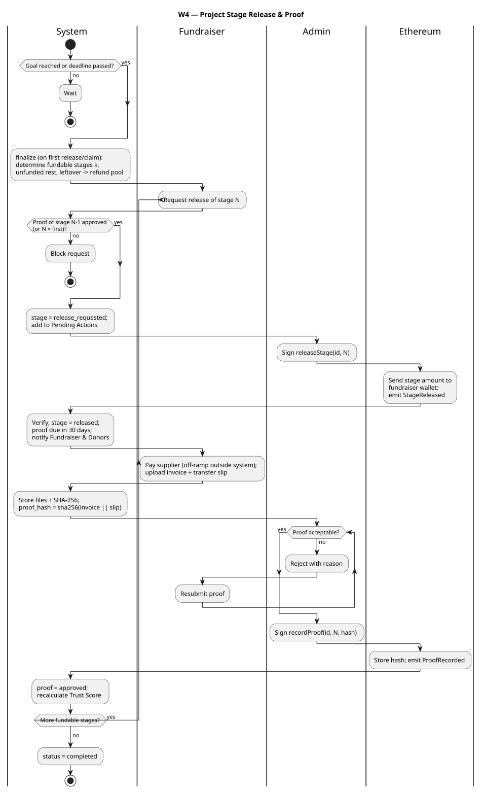
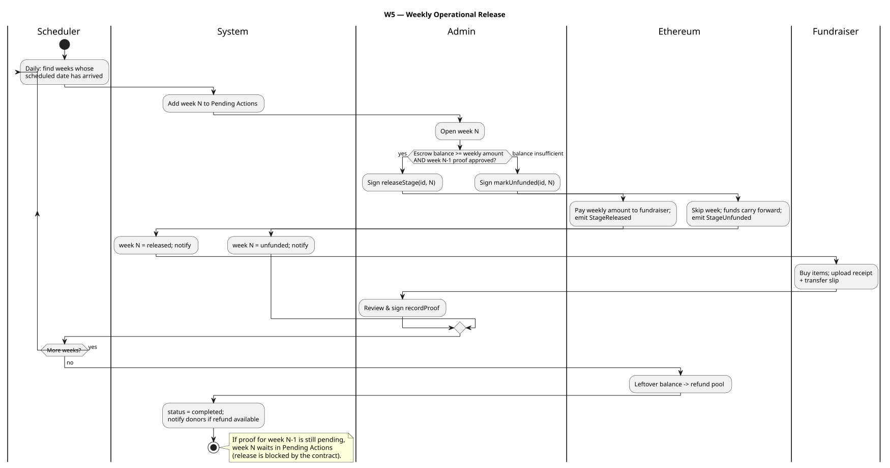
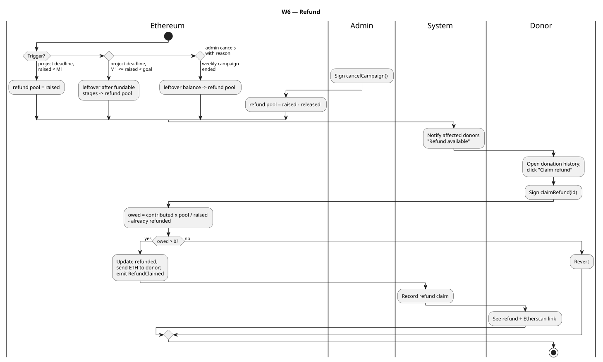
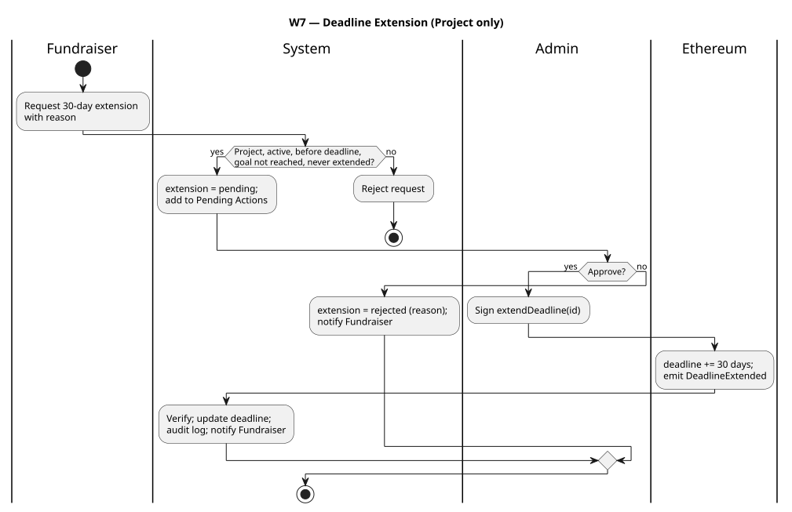

# Activity Diagrams — CrowdChain

These seven diagrams cover the main workflows (W1–W7) summarised in
[SRS §3](01-srs.md#3-main-workflows). Each diagram uses **swimlanes** to show
who performs each step: Fundraiser, Donor, Admin, System (Laravel + SPA),
Ethereum (the contract) and Scheduler.

| ID | Workflow | Source | Use cases |
|---|---|---|---|
| W1 | Fundraiser onboarding | [`activity-w1-onboarding.puml`](diagrams/activity-w1-onboarding.puml) | UC03, UC07, UC12, UC21 |
| W2 | Campaign publication | [`activity-w2-publish.puml`](diagrams/activity-w2-publish.puml) | UC14, UC15, UC22 |
| W3 | Donation | [`activity-w3-donate.puml`](diagrams/activity-w3-donate.puml) | UC09 |
| W4 | Project stage release & proof | [`activity-w4-project-release.puml`](diagrams/activity-w4-project-release.puml) | UC18, UC24, UC19, UC26 |
| W5 | Weekly operational release | [`activity-w5-weekly-release.puml`](diagrams/activity-w5-weekly-release.puml) | UC24, UC25, UC19, UC26 |
| W6 | Refund | [`activity-w6-refund.puml`](diagrams/activity-w6-refund.puml) | UC27, UC11 |
| W7 | Deadline extension | [`activity-w7-extension.puml`](diagrams/activity-w7-extension.puml) | UC17, UC23 |

---

## W1 — Fundraiser onboarding

**Key points:** the wallet must be linked *before* verification, because it
becomes the receiving address for every future campaign. Rejection loops back
to editing, with no limit on resubmissions.

## W2 — Campaign publication

**Key points:** RM → wei conversion happens at **approval time**, not at
creation (D-40). The campaign becomes `active` only after the backend has
verified the `CampaignCreated` event, so the database never shows a campaign
that does not exist on-chain.

## W3 — Donation

**Key points:** the contract is the final judge (it reverts on overfunding or
a late donation), even though the UI checks the same rules first. If the
browser closes after payment, `chain:sync` records the donation later.

## W4 — Project stage release & proof

**Key points:** every stage follows the loop **request → release → spend →
proof → record hash**. The contract's `awaitingProof` flag makes it
*technically impossible* to release stage N+1 before the proof hash for
stage N is on-chain. This is the core answer to problem P3 (misuse of funds).

## W5 — Weekly operational release

**Key points:** there is no deadline-based finalisation. Each week is decided
on its own date: **release** if there is enough money and the previous proof
is in, otherwise **mark unfunded** and carry the money forward.

## W6 — Refund

**Key points:** four different triggers all end in the same pull-based claim.
The formula `contributed × pool ÷ raised − already refunded` handles partial
pools and later cancellations correctly (see contract design §3.3).

## W7 — Deadline extension

**Key points:** allowed once, for Project campaigns only (see the open
clarification in [contract design §9](12-smart-contract-design.md#9-clarification-introduced-by-this-design)).
