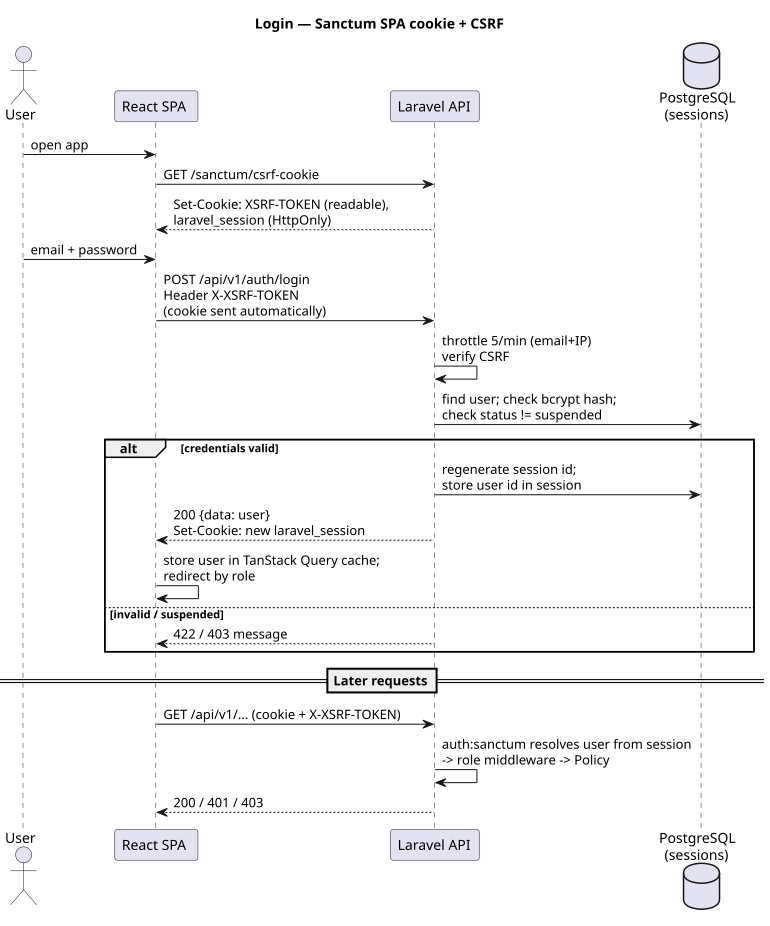
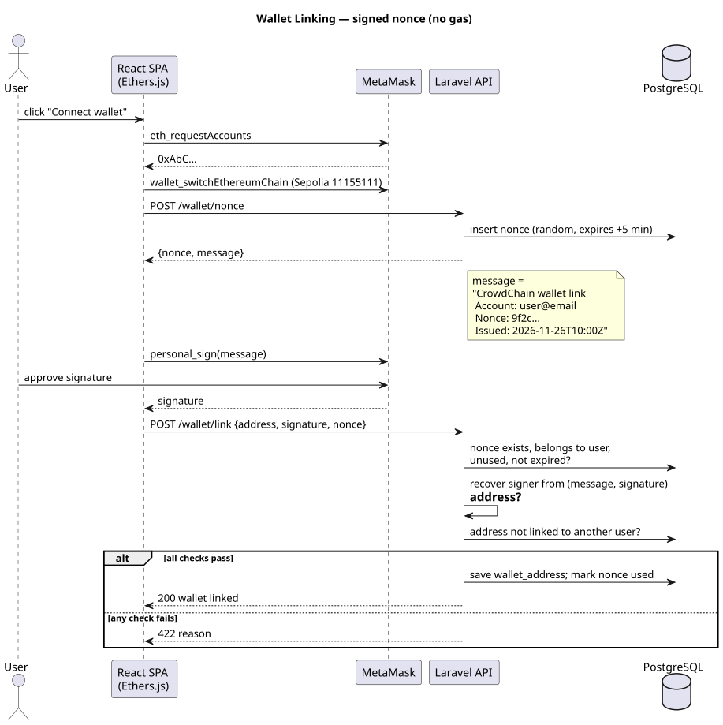
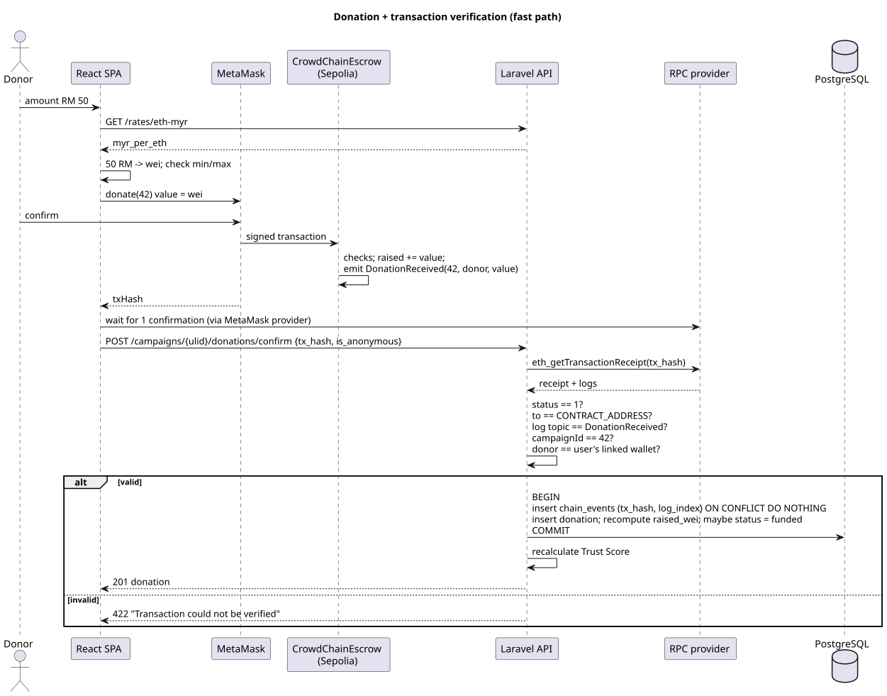
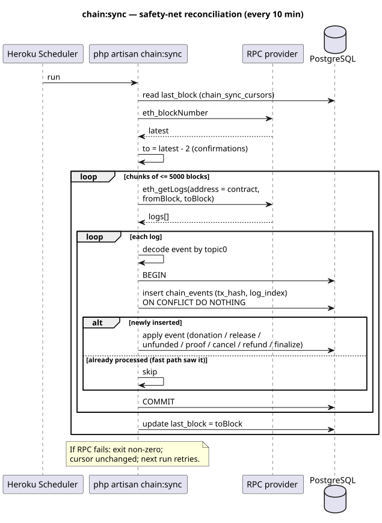

# Authentication, Authorisation and Trust Flows — CrowdChain

## 1. Authentication: Sanctum SPA cookie mode

Source: [`diagrams/seq-login.puml`](diagrams/seq-login.puml)



**How it works:** Laravel keeps the login in a **server-side session**.
The browser only holds a session cookie marked `HttpOnly`, so JavaScript,
including any injected malicious script, cannot read it. Because the SPA and
the API share one origin on Heroku, the browser sends this cookie
automatically.

The second cookie, `XSRF-TOKEN`, *is* readable by JavaScript. Axios copies it
into the `X-XSRF-TOKEN` header. A malicious site can make your browser send
the cookie, but it cannot read the token, so its forged requests fail with
**419**. This is how CSRF protection works.

| Setting | Value | Why |
|---|---|---|
| `SESSION_DRIVER` | `database` | Heroku dynos restart daily and lose their files |
| `SESSION_SECURE_COOKIE` | `true` (production) | Cookie sent over HTTPS only |
| `SESSION_SAME_SITE` | `lax` | Blocks most cross-site sends |
| `SANCTUM_STATEFUL_DOMAINS` | the app's own domain (+ `localhost:5173` in development) | Tells Sanctum which origins use cookie auth |
| Session lifetime | 120 minutes idle; "remember me" 30 days | Balance between security and convenience |
| Login throttle | 5 per minute per email + IP | Brute-force protection (NFR-SEC-04) |

## 2. Authorisation: three gates

Every request passes three gates, in order:

```
① Middleware      auth:sanctum   → logged in?                         else 401
                  verified        → email verified? (for actions)       else 403
                  role:fundraiser → correct role?                       else 403
                  not-suspended   → account active?                     else 403
② Policy          CampaignPolicy@update → owns it? status allows it?    else 403
③ Service rules   CampaignService::submit → org verified, not expired,
                  within active limit, wallet linked?                   else 409/422
```

The React route guards mirror ① for a better user experience, but **security
is enforced only on the server** (see [Roles & Permissions §3](04-roles-permissions.md#3-enforcement)).

Example policy rules:

| Policy | Rule |
|---|---|
| `OrganizationPolicy@view` | Owner or admin |
| `CampaignPolicy@update` | Owner, and status ∈ {draft, rejected}; or owner, status approved and only text/image fields |
| `CampaignPolicy@requestRelease` | Owner; project; status `funded` |
| `ProofPolicy@create` | Owner of the campaign; stage `released`; no approved proof |
| `DocumentPolicy@view` | Public file → anyone; private file → uploader or admin |
| `DonationPolicy@confirm` | Donor role; the transaction sender equals the caller's linked wallet |

## 3. Wallet linking

Source: [`diagrams/seq-wallet-link.puml`](diagrams/seq-wallet-link.puml)



**Why sign a message?** Anyone can *type* someone else's wallet address. Only
the real owner can produce a signature that mathematically recovers to that
address. The nonce makes each signature single-use, so a captured signature
cannot be replayed. Signing costs no gas because nothing is sent to the
blockchain.

## 4. Transaction verification (fast path)

Source: [`diagrams/seq-tx-verify.puml`](diagrams/seq-tx-verify.puml)



**The backend never trusts the browser.** A browser could send a hash of a
failed transaction, a transaction to another contract, someone else's
donation, or the same hash twice. Each of those is rejected by the checks
below:

| Check | Defeats |
|---|---|
| `receipt.status == 1` | Reverted/failed transactions |
| `receipt.to == CONTRACT_ADDRESS` | Transactions to a fake contract |
| Event signature (topic0) and decoded arguments match the expected action, campaign and stage | Using a donation hash to "confirm" a release, or a different campaign |
| Sender/donor == the caller's linked wallet (for donor actions) | Claiming someone else's donation |
| `(tx_hash, log_index)` is unique in `chain_events` | Replay / double counting |
| The block has at least 1 confirmation | Reorganised (dropped) blocks |

## 5. Chain sync (safety net)

Source: [`diagrams/seq-chain-sync.puml`](diagrams/seq-chain-sync.puml)



## 6. Admin on-chain actions

The admin's wallet is the contract `owner`. When the admin clicks an action
such as "Release", the SPA:

1. checks that the connected MetaMask account equals the configured owner address (otherwise it shows "Connect the admin wallet");
2. calls the contract function;
3. sends the `txHash` to the matching `…/confirm` endpoint;
4. the API verifies the transaction (§4) **and** that the sender is the owner, then writes the audit log entry with the `tx_hash`.

No private key exists anywhere on the server (NFR-SEC-08).

## 7. Secrets and configuration

| Variable | Where | Secret? |
|---|---|---|
| `APP_KEY` | Heroku Config Var | ✅ (also encrypts IC and bank fields) |
| `DATABASE_URL` | Set by the Heroku Postgres add-on | ✅ |
| `SEPOLIA_RPC_URL` | Config Var | ✅ (contains the API key) |
| `CONTRACT_ADDRESS`, `CHAIN_ID`, `CONTRACT_DEPLOY_BLOCK` | Config Var + Vite `VITE_*` | ❌ public |
| `ADMIN_WALLET_ADDRESS` | Config Var + Vite | ❌ public |
| `R2_ACCESS_KEY_ID`, `R2_SECRET_ACCESS_KEY`, `R2_BUCKET`, `R2_ENDPOINT` | Config Var | ✅ |
| `COINGECKO_API_KEY` | Config Var | ✅ |
| `MAIL_*` (Brevo) | Config Var | ✅ |
| Hardhat deployer private key | Developer laptop `contracts/.env` **only**, never committed, never on Heroku | ✅ |

`VITE_*` variables are compiled into the public JavaScript bundle, so **only
non-secret values** may use that prefix.
